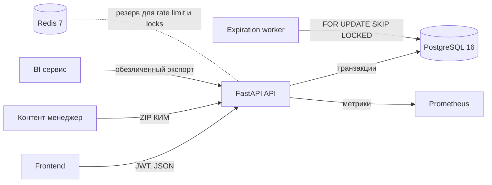

# Архитектура backend ОГЭ

Backend — stateless FastAPI-приложение. PostgreSQL хранит нормализованные транзакционные данные и является источником истины. Redis выделен для краткоживущих распределённых механизмов; в текущей учебной сборке блокировка попыток входа и критические операции реализованы транзакционно в PostgreSQL. Несколько экземпляров API могут работать с одной БД. Отдельный worker закрывает просроченные сессии; повторный запуск безопасен.

## Ключевые транзакции

1. Импорт КИМ валидирует ZIP до записи, затем атомарно создаёт версию пакета, файлы, версии заданий и варианты. SHA-256 пакета уникален; ошибка не оставляет предметных данных. Отклонённый пакет сохраняет только протокол.
2. Запуск сессии блокирует назначение и проверяет окно экзамена. Частичный уникальный индекс разрешает только одну активную сессию на назначение.
3. Сохранение ответа блокирует сессию и ответ, сравнивает ожидаемую ревизию, сохраняет историю и идемпотентный ответ в одной транзакции.
4. Завершение сессии в той же транзакции запускает автоматическую проверку или создаёт две независимые экспертные задачи. Результат появляется после всех обязательных проверок.
5. Экспертный claim — условный SQL `UPDATE`, арендующий задачу на 15 минут. Существенное расхождение создаёт спор для старшего эксперта.
6. Пересчёт добавляет новую версию результата. Прежние версии и версии правил сохраняются.

## Границы доверия

Клиентское время события контроля сохраняется как наблюдение и не участвует в серверном таймере. Ключи ответов и критерии доступны только контентным ролям и серверным сервисам. Очередь экспертов содержит ответ и критерии без участника и идентификатора сессии. BI получает баллы по заданиям и псевдоним без логинов, токенов и текста ответа.

TLS 1.2+ завершается перед API на reverse proxy. В production нужно задать длинный случайный `JWT_SECRET`, отдельный `METRICS_TOKEN`, CORS allowlist и сетевые правила для PostgreSQL/Redis. Подробнее — в [security.md](security.md).
