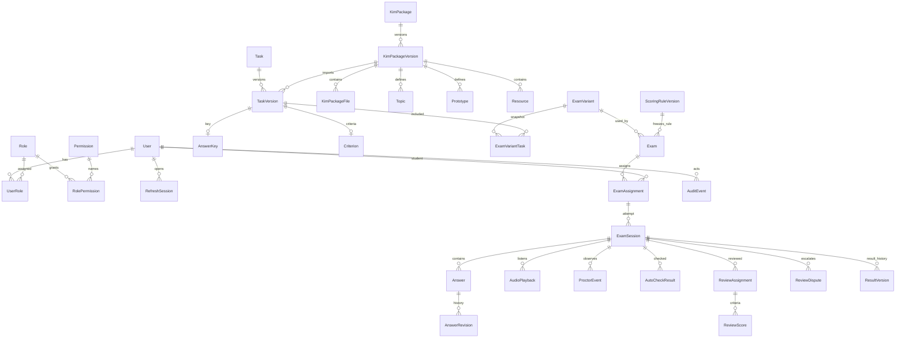

# ER диаграмма

Диаграмма показывает основные связи; полный набор индексов и ограничений задают модели SQLAlchemy и миграции Alembic.

`ExamVariantTask` фиксирует конкретную опубликованную версию задания. `Exam.scoring_rule_id` фиксирует правила на момент создания экзамена. `ResultVersion` содержит разбивку, версию правила и причину геометрического ограничения. История ответов, оценок и событий аудита не удаляется каскадно.
